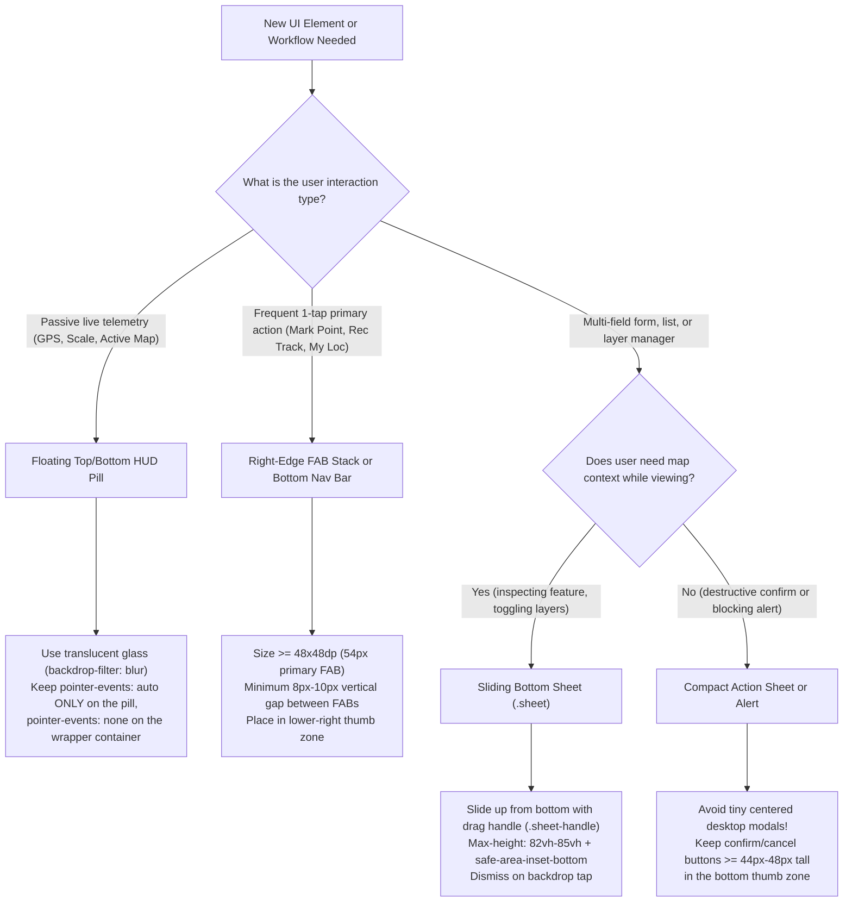

# Android & Field Mobile UI/UX Design

Use this skill to design, audit, and polish Android mobile interfaces—especially map-centric, sensor-driven, or outdoor field apps built with Capacitor, WebView, or hybrid CSS frameworks.

---

## 1. Black-Box UI/UX Ergonomics Auditor (`--help` First)

Before manually inspecting huge stylesheets for missing safe-area insets, undersized buttons, or z-index collisions, run the bundled black-box CLI audit tool. **Do not read the script source code**—invoke it with `--help` first, then run it against the app directory:

```powershell
# 1. View CLI usage and flags
node .agents/skills/android-mobile-ui-ux/scripts/audit_mobile_ui.cjs --help

# 2. Run static UI/UX audit against the mobile web directory
node .agents/skills/android-mobile-ui-ux/scripts/audit_mobile_ui.cjs ./app

# 3. Emit machine-readable JSON for automated checks
node .agents/skills/android-mobile-ui-ux/scripts/audit_mobile_ui.cjs ./app --json
```

---

## 2. Decision Tree: Choosing the Right Android UI Pattern

Use this decision tree whenever adding a new control, form, status readout, or workflow to an Android screen:



---

## 3. Core Android UI/UX Rules & Material Design 3 Standards

### A. Touch Target Sizing & Spacing (48×48dp Rule)
1. **Primary Interactive Controls:** Every primary button, FAB, and bottom navigation tab MUST have a minimum hit target of **`48px × 48px`** (`48dp × 48dp`), with **`52px–56px`** preferred for primary field actions (e.g., recording a GPS waypoint with gloves or wet hands).
2. **Compact Inline Actions:** Secondary icon buttons inside list cards or headers must be at least **`36px × 36px`** (or use invisible padding to expand the hit area) with at least **`8px` (`8dp`) separation** between adjacent targets to prevent accidental mis-taps.
3. **Tactile Feedback:** Suppress the default Android WebView blue tap highlight (`-webkit-tap-highlight-color: transparent`) and provide immediate physical press feedback:
   ```css
   .fab:active, .btn:active, .icon-btn:active {
     transform: scale(0.95);
   }
   ```

### B. Edge-to-Edge Safe Areas & System Insets
1. **HTML Viewport Meta Tag:** Always include `viewport-fit=cover` and disable accidental page pinch-zoom in `index.html`:
   ```html
   <meta name="viewport" content="width=device-width, initial-scale=1.0, maximum-scale=1.0, user-scalable=no, viewport-fit=cover" />
   ```
2. **Top Camera Cutout & Status Bar:** Offset the top HUD container using `env(safe-area-inset-top, 0px)`:
   ```css
   .hud-top {
     padding-top: calc(env(safe-area-inset-top, 0px) + 10px);
   }
   ```
3. **Bottom Gesture Pill & Navigation Bar:** Offset bottom navigation bars and sliding bottom sheets using `env(safe-area-inset-bottom, 0px)`:
   ```css
   .bottom-nav, .sheet {
     padding-bottom: calc(env(safe-area-inset-bottom, 0px) + 12px);
   }
   ```

### C. Pass-Through HUD Containers (`pointer-events` Architecture)
When placing floating HUD bars over an interactive canvas (such as OpenLayers or MapLibre), the full-width wrapper **must not block map pans or pinch gestures**:
```css
/* Wrapper spans width but lets map touches pass through */
.hud-top, .coord-bar {
  pointer-events: none;
}
/* Only actual interactive pills/buttons capture taps */
.hud-top > *, .coord-bar > * {
  pointer-events: auto;
}
```

### D. Deterministic Z-Index Layer Stack
Maintain a strict, non-overlapping z-index hierarchy so floating map controls never collide with sheets or system banners:
- **`z-index: 1–10`**: Map canvas & tile/raster layers
- **`z-index: 20`**: Passive map attributions & dynamic `ScaleLine` (anchored above the bottom coordinate bar so they never overlap)
- **`z-index: 30`**: Floating HUD pills (`.hud-top`, `.coord-bar`, `.fab-stack`)
- **`z-index: 40`**: Sticky Bottom Navigation Bar (`.bottom-nav`)
- **`z-index: 90`**: Sheet Backdrop Scrim (`.sheet-backdrop`)
- **`z-index: 100`**: Sliding Bottom Sheets (`.sheet`)
- **`z-index: 200+`**: Full-screen modals (Camera viewfinder, Onboarding) & Toast notifications (`.toast`)

### E. Outdoor Sunlight Legibility & Semantic Status Colors
1. **High-Contrast Surfaces:** Combine dark slate surfaces (`rgba(15, 23, 42, 0.90)`) with `backdrop-filter: blur(16px)` and subtle `1px` bright borders (`rgba(255, 255, 255, 0.12)`) so floating pills remain legible over both bright topographic white backgrounds and dark satellite imagery.
2. **Tabular Numerals for Live Telemetry:** Always apply `font-variant-numeric: tabular-nums` (or `JetBrains Mono`) to live GPS coordinates, timers, and accuracy readouts so numbers do not jitter horizontally when updating every second.
3. **Semantic Field Status Chips:**
   - **Good / Locked (`<= 5m`):** Emerald Green (`#10b981`)
   - **Moderate / Warning (`5m–15m`):** Amber Orange (`#f59e0b`)
   - **Poor / Recording / Destructive (`> 15m` or active rec):** Rose Red (`#ef4444`) with pulsing indicator dot.

