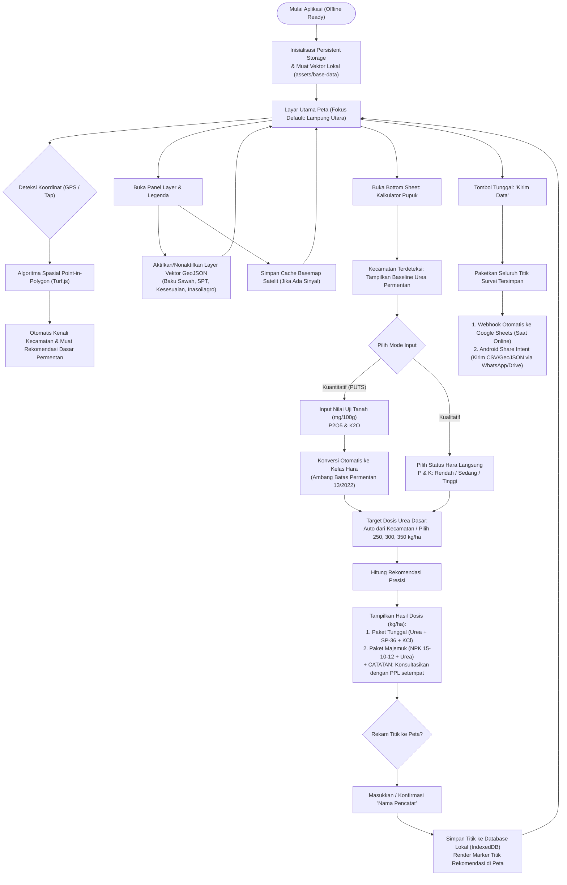

# IMPLEMENTATION PLAN & ARSITEKTUR SISTEM (TERREVISI)
## Aplikasi Android & Web: "Pupuk Presisi Padi" (Kabupaten Lampung Utara)

> **Status Dokumen**: Disetujui & Disesuaikan dengan Komentar Pengguna  
> **Target Wilayah Studi**: Kabupaten Lampung Utara, Provinsi Lampung  
> **Dasar Regulasi**: Peraturan Menteri Pertanian Republik Indonesia No. 13 Tahun 2022  
> **Standar UI/UX**: Android Material Design 3, Outdoor High-Contrast, Ergonomi Lapangan 48×48dp  
> **Teknologi**: React 18 + Vite + TypeScript + Tailwind CSS + Leaflet.js + Capacitor 6 (Android)

---

## 1. Ringkasan Eksekutif & Tujuan Proyek

Aplikasi **"Pupuk Presisi Padi"** (nama sementara) dikembangkan untuk membantu petani dan penyuluh pertanian lapangan (PPL) menentukan dosis pupuk berimbang secara presisi serta memetakan lokasi lahan sawah secara *offline*.

Aplikasi ini dibangun menggunakan arsitektur *Hybrid-Ready*:
1. **Fase Web Demo (PWA)**: Di-*deploy* ke **GitHub Pages** agar dapat segera diakses publik melalui tautan peramban oleh tim peneliti dan pemangku kepentingan untuk pengujian (*review*).
2. **Fase Native Android APK**: Dikemas menggunakan **Capacitor 6** menjadi file instalasi mandiri (`.apk`) untuk pengujian langsung di sawah tanpa sinyal, dan disiapkan dalam format Android App Bundle (`.aab`) untuk rilis ke **Google Play Store**.

---

## 2. Spesifikasi Teknis & Arsitektur Solusi

| Komponen | Pilihan Teknologi | Alasan Pemilihan |
| :--- | :--- | :--- |
| **Framework Frontend** | React 18 + Vite + TypeScript + Tailwind CSS | Performa sangat cepat, ukuran *bundle* ringan (<2MB), kompatibel dengan peramban lawas, dan mudah di-export ke Web statis maupun Capacitor Android. |
| **GIS & Map Engine** | Leaflet.js + Turf.js (Point-in-Polygon) + Tile Caching | Ringan untuk Web & WebView Android, konsumsi RAM rendah di ponsel *entry-level*, rendering GeoJSON cepat, dan mendukung deteksi otomatis posisi pengguna di poligon kecamatan. |
| **Hardware & Native Bridge** | Capacitor 6 (`@capacitor/core`, `@capacitor/geolocation`, `@capacitor/filesystem`, `@capacitor/share`) | Akses sensor GNSS native tanpa overhead berat, penyimpanan ke Scoped Storage, dan integrasi Android Share Intent (WhatsApp/Bluetooth). |
| **Penyimpanan Offline** | IndexedDB (LocalForage) + Scoped Storage (`Documents/PupukPresisi/`) | Data riwayat survei dan nama pencatat tersimpan persisten bahkan saat aplikasi ditutup atau tanpa koneksi internet sama sekali. |
| **Ikonografi & Aset** | Lucide Icons (`lucide-react`) + Logo Resmi (`assets/logo/`) | Kontras tinggi, ukuran vektor SVG tajam dan ringan. |
| **Hosting Demo** | GitHub Pages (`gh-pages` branch / GitHub Actions) | Gratis, cepat diakses oleh tim peneliti dari tautan publik tanpa perlu instalasi server. |

---

## 3. Landasan Regulasi & Logika Kalkulator Pemupukan (Permentan No. 13/2022)

Perhitungan dosis pupuk mengacu secara ketat pada teks resmi **Permentan No. 13 Tahun 2022**:

### A. Kriteria Status Hara Tanah (Pasal 5 & 6)
Penilaian status hara tanah diklasifikasikan ke dalam 3 kelas:
1. **Status Rendah**:
   - Fosfor ($\text{P}_2\text{O}_5$): $< 20\text{ mg}/100\text{ g}$ tanah
   - Kalium ($\text{K}_2\text{O}$): $< 10\text{ mg}/100\text{ g}$ tanah
2. **Status Sedang**:
   - Fosfor ($\text{P}_2\text{O}_5$): $20 - 40\text{ mg}/100\text{ g}$ tanah
   - Kalium ($\text{K}_2\text{O}$): $10 - 20\text{ mg}/100\text{ g}$ tanah
3. **Status Tinggi**:
   - Fosfor ($\text{P}_2\text{O}_5$): $> 40\text{ mg}/100\text{ g}$ tanah
   - Kalium ($\text{K}_2\text{O}$): $> 20\text{ mg}/100\text{ g}$ tanah

### B. Mode Input Pengguna & Deteksi Spasial Kecamatan
1. **Deteksi Spasial Kecamatan Otomatis (Point-in-Polygon)**:
   - Ketika pengguna mengaktifkan GPS atau memilih titik di peta, sistem menggunakan algoritma spasial *Point-in-Polygon* (PIP) untuk mendeteksi poligon kecamatan tempat pengguna berada.
   - **Tabel Rekomendasi Resmi Permentan 13/2022**: Di dalam **Lampiran Permentan No. 13 Tahun 2022**, Kementerian Pertanian memang telah menyusun tabel baku rekomendasi dosis pupuk per kecamatan untuk seluruh wilayah Indonesia.
   - Seluruh 23 kecamatan di Kabupaten Lampung Utara sudah tercakup di file spasial kita (`rekomendasi_pupuk_padi_lampura.geojson`) dengan nilai rekomendasi dasar ($250\text{ kg Urea/ha}$, status P Rendah, K Tinggi).
   - *Fallback*: Jika GPS mati atau berada di luar batas, disediakan *dropdown* pemilih kecamatan manual.

2. **Mode Kualitatif**: Pengguna memilih langsung status hara P dan K (Rendah / Sedang / Tinggi).
3. **Mode Kuantitatif (PUTS)**: Pengguna memasukkan angka hasil analisis uji tanah ($\text{P}_2\text{O}_5$ dan $\text{K}_2\text{O}$ dalam $\text{mg}/100\text{ g}$ tanah), lalu sistem mengonversinya secara otomatis ke status kualitatif sesuai ambang batas Permentan.
4. **Target Dosis Urea Dasar**:
   - Default terisi otomatis dari data kecamatan ($250\text{ kg/ha}$).
   - Pengguna tetap dapat mengubah ke $300\text{ kg/ha}$ atau $350\text{ kg/ha}$ jika memiliki target hasil panen yang lebih tinggi (5–7 ton/ha).

### C. Output Rekomendasi Pemupukan (Pasal 8 & 9)
* **Paket Pupuk Tunggal** (per hektar per musim):
  - **Fosfor (SP-36)**: Rendah = $100\text{ kg/ha}$, Sedang = $75\text{ kg/ha}$, Tinggi = $50\text{ kg/ha}$.
  - **Kalium (KCl)**: Rendah = $100\text{ kg/ha}$, Sedang/Tinggi = $50\text{ kg/ha}$.
  - **Urea**: Sesuai target hasil / kecamatan ($250 / 300 / 350\text{ kg/ha}$).
* **Paket Pupuk Majemuk** (Substitusi formula NPK 15-10-12 + Urea):
  - **P Rendah**: $375\text{ kg NPK 15-10-12} + (125 / 175 / 225)\text{ kg Urea}$.
  - **P Sedang**: $300\text{ kg NPK 15-10-12} + (150 / 200 / 250)\text{ kg Urea}$.
  - **P Tinggi**: $250\text{ kg NPK 15-10-12} + (175 / 225 / 275)\text{ kg Urea}$.

> [!IMPORTANT]
> **CATATAN PENTING**: Di setiap layar hasil rekomendasi, pop-up peta, dan dokumen ekspor, ditampilkan peringatan:  
> *"Konsultasikan hasil ini dengan penyuluh (PPL) setempat."*

---

## 4. Arsitektur Sistem & Alur Kerja (Mermaid)

### A. Alur Pengguna (*User Flow Diagram*)


---

## 5. Desain Antarmuka Pengguna (ASCII Wireframes)

### Layar 1: Tampilan Utama Peta (*Main Map Canvas & Floating HUD*)
```text
+-------------------------------------------------------------+  ▲
| [KEMENTAN] [HITI] [ICARE]                   [Sun/Moon]  [=] |  │ Top Safe Area
+-------------------------------------------------------------+  ▼ env(safe-area-inset-top)
| [GPS: AKTIF | ±3.2m]                      [Kompas: N ▲]     |  <- Floating HUD Pill
|                                                             |
|                       _.-''''-._                            |
|                     .'          '.                          |
|                    /   POLIGON    \                         |
|                   | LAMPUNG UTARA  |                        |
|                    \   (LAYER)    /                         |
|                     '.          .'                          |
|                       '-.____.-'                            |
|                                                             |
|                          (X) <- [Titik Rekomendasi Tersimpan]
|                                                             |
|                              [+]                            |
|                              [-] Zoom Controls              |
|                                                             |
|                              [ (O) ] GPS Recenter FAB (54dp)|
|                              [ (L) ] Layer & Legenda FAB    |
| [Skala: |== 50m ==| ]        [ (C) ] Kalkulator Pupuk FAB   |
+-------------------------------------------------------------+  ▲
|  Kec. Bukit Kemuning | -4.83645 S, 104.59337 E | Terdeteksi |  │ Bottom Bar
+-------------------------------------------------------------+  ▼ env(safe-area-inset-bottom)
```

### Layar 2: Panel Kalkulator Pemupukan dengan Deteksi Kecamatan
```text
+-------------------------------------------------------------+
|                         [   ===   ]                         |  <- Drag Handle
| KALKULATOR PEMUPUKAN PADI SAWAH                     [ ? ]   |  <- Tombol Bantuan
+-------------------------------------------------------------+
| LOKASI KECAMATAN (PERMENTAN 13/2022):                       |
| [📍 Kec. Bukit Kemuning, Kab. Lampung Utara             v ] |  <- Auto-detected (bisa diubah)
+-------------------------------------------------------------+
| MODE ANALISIS TANAH:                                        |
| [ (•) Mode Kualitatif ]     [ ( ) Mode Kuantitatif (PUTS) ] |  <- Segmented Toggle (48dp)
+-------------------------------------------------------------+
| [MODE KUALITATIF]:                                          |
| 1. Status Hara Fosfor (P):                                  |
|    ( ) Rendah          (•) Sedang          ( ) Tinggi       |
| 2. Status Hara Kalium (K):                                  |
|    (•) Rendah          ( ) Sedang          ( ) Tinggi       |
|                                                             |
| [MODE KUANTITATIF (PUTS)]:                                  |
| 1. Kadar P2O5 (mg/100g): [  28.5  ] -> Status: SEDANG (Otomatis)
| 2. Kadar K2O  (mg/100g): [   8.2  ] -> Status: RENDAH (Otomatis)
|                                                             |
| TARGET DOSIS UREA DASAR (PERMENTAN 13/2022):                |
| [ (•) 250 kg/ha (Kecamatan) ] [ ( ) 300 kg/ha ] [ ( ) 350 kg/ha ]
+-------------------------------------------------------------+
| HASIL REKOMENDASI DOSIS PER HEKTAR (1 MUSIM TANAM):         |
|                                                             |
| +-- [OPSI A] PAKET TUNGGAL -------------------------------+ |
| | • Urea  : 250 kg/ha                                     | |
| | • SP-36 :  75 kg/ha                                     | |
| | • KCl   : 100 kg/ha                                     | |
| +---------------------------------------------------------+ |
| +-- [OPSI B] PAKET MAJEMUK (SUBSTITUSI NPK 15-10-12) -----+ |
| | • NPK 15-10-12 : 300 kg/ha                              | |
| | • Urea Tambahan: 150 kg/ha                              | |
| +---------------------------------------------------------+ |
|                                                             |
| ⚠️ CATATAN:                                                 |
| "Konsultasikan hasil ini dengan penyuluh (PPL) setempat."   |
|                                                             |
| FORM PEREKAMAN TITIK LAPANGAN:                              |
| Nama Pencatat : [ Budi Santoso (PPL)                    ]   |
| Titik Lokasi  : [X] GPS Device (-4.83645 S, 104.59337 E)    |
|                 [ ] Manual Pick dari Peta                   |
| Waktu Catat   : 06 Nov 2026, 16:30 WIB (Otomatis)           |
|                                                             |
| [ SIMPAN REKOMENDASI KE PETA ]  (Primary Button 54dp, Green)|
+-------------------------------------------------------------+
```

---

## 6. Rencana Eksekusi Bertahap (Milestones)

### Fase 1: Setup Core & Web Demo (GitHub Pages Ready)
- [ ] Inisialisasi proyek: Vite + React 18 + TypeScript + Tailwind CSS + Lucide Icons + Leaflet + Turf.js.
- [ ] Deteksi otomatis kecamatan via *Point-in-Polygon* dari koordinat pengguna.
- [ ] Implementasi kalkulator Permentan No. 13/2022 (Mode Kualitatif & Kuantitatif PUTS + CATATAN PPL).
- [ ] Antarmuka peta responsif: Floating HUD, kontrol zoom, kompas, dan switch Dark/Light mode.
- [ ] Penyusunan Modal Bantuan edukatif berdasar pasal-pasal Permentan.

### Fase 2: GIS Offline, Perekaman Titik & Tombol "Kirim Data"
- [ ] Render poligon tematik `rekomendasi_pupuk_padi_lampura.geojson` (23 kecamatan).
- [ ] Checklist layer GeoJSON dinamis dan fitur *tile caching*.
- [ ] Form perekaman titik: Nama Pencatat, auto timestamp, opsi GPS / manual tap.
- [ ] Tombol terpadu **"Kirim Data"** (ekspor batch CSV/GeoJSON + webhook Google Sheets + Share Intent).

### Fase 3: Rilis Web Demo di GitHub Pages
- [ ] Konfigurasi `vite.config.ts` (`base: './'`).
- [ ] Setup deploy otomatis GitHub Actions / `gh-pages`.
- [ ] Uji coba akses publik oleh tim peneliti melalui ponsel dan browser desktop.

### Fase 4: Build Android APK (Capacitor) & Google Play Store
- [ ] Inisialisasi `@capacitor/core` dan `@capacitor/android`.
- [ ] Konfigurasi `AndroidManifest.xml` (akses lokasi presisi `ACCESS_FINE_LOCATION`, `largeHeap`).
- [ ] Optimasi daya baterai GNSS (sensor mati saat background / toggle OFF).
- [ ] Generate file `.apk` mandiri untuk *sideloading* di lapangan.
- [ ] Konfigurasi Keystore & ProGuard untuk rilis `.aab` ke Google Play Store.

---

## 8. Panduan Lengkap Hosting Web Demo ke GitHub Pages (Akses Tim Peneliti)

Agar tim peneliti dan pemangku kepentingan dapat mengakses aplikasi ini secara online dari HP atau laptop tanpa perlu menginstal aplikasi terlebih dahulu, ikuti langkah-langkah berikut:

### Langkah 1: Buat Repository Baru di GitHub
1. Buka [GitHub.com](https://github.com/) dan masuk ke akun Anda.
2. Klik tombol **New** (Buat Repository Baru).
3. Beri nama repository, misalnya: `pupuk-presisi-padi`.
4. Pilih opsi **Public** agar dapat diakses oleh tim lain, lalu klik **Create repository** (jangan centang Add README karena kode lokal sudah lengkap).

### Langkah 2: Hubungkan Folder Lokal dan Unggah (Push) ke GitHub
Buka terminal PowerShell di folder proyek ini (`c:\Projects-antigravity\pupuk-presisi`), lalu jalankan baris perintah berikut secara berurutan:

```powershell
# 1. Inisialisasi Git lokal (jika belum)
git init

# 2. Tambahkan semua file dan buat commit awal
git add .
git commit -m "feat: inisialisasi aplikasi web pupuk presisi padi lampung utara"

# 3. Ubah nama branch utama ke 'main'
git branch -M main

# 4. Hubungkan remote repository GitHub Anda (ganti <username-anda> dengan username GitHub Anda)
git remote add origin https://github.com/<username-anda>/pupuk-presisi-padi.git

# 5. Unggah kode ke GitHub
git push -u origin main
```

### Langkah 3: Konfigurasi GitHub Pages
1. Di halaman repository GitHub Anda, klik tab **Settings** (di menu atas).
2. Di sidebar sebelah kiri, klik menu **Pages**.
3. Pada bagian **Build and deployment**:
   - Di menu dropdown **Source**, pilih **GitHub Actions**.
4. GitHub Actions akan secara otomatis menjalankan alur kerja dari file [`.github/workflows/deploy.yml`](file:///c:/Projects-antigravity/pupuk-presisi/.github/workflows/deploy.yml) yang telah kita siapkan.
5. Tunggu sekitar 1–2 menit hingga proses build selesai.

### Langkah 4: Bagikan Tautan Web Demo ke Tim Peneliti
Setelah proses build selesai, halaman demo akan aktif di tautan publik:
```text
https://<username-anda>.github.io/pupuk-presisi-padi/
```
* **Kelebihan untuk Pengujian**:
  - Tim peneliti dapat langsung membuka tautan tersebut dari browser ponsel (Chrome/Safari) maupun laptop.
  - Tampilan akan langsung responsif menyerupai aplikasi Android.
  - Tim dapat mencoba menghitung dosis pupuk, mengetuk poligon kecamatan Lampung Utara, dan mencoba fitur ekspor survei secara langsung untuk memberikan masukan.

