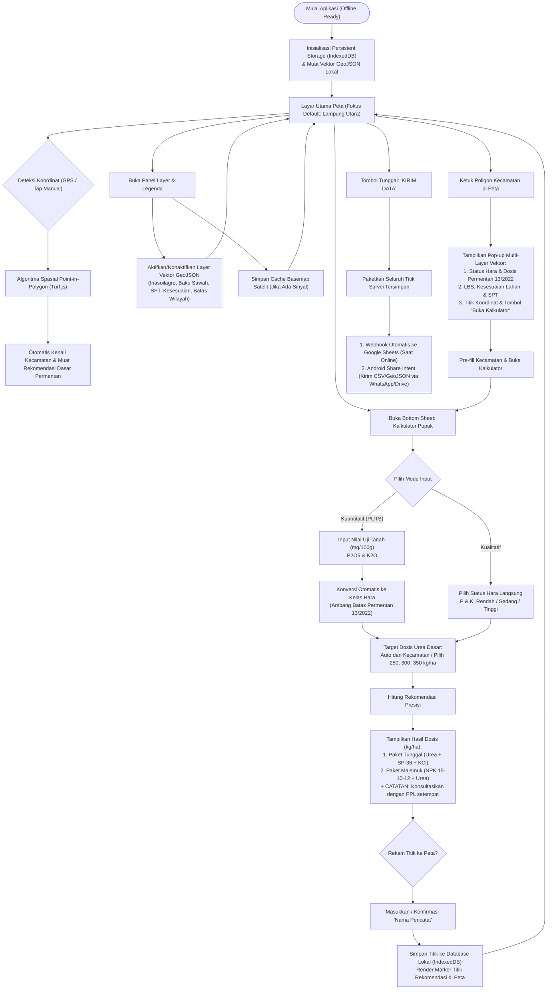

# IMPLEMENTATION PLAN & ARSITEKTUR SISTEM (LENGKAP & TERINTEGRASI)
## Aplikasi Android & Web: "Pupuk Presisi Padi" (Kabupaten Lampung Utara)

> **Status Proyek**: Fase 1–3 SELESAI (Production-Ready Web PWA & GitHub Pages Live), Siap Fase 4 (Capacitor Android APK)  
> **Target Wilayah Studi**: 23 Kecamatan di Kabupaten Lampung Utara, Provinsi Lampung  
> **Dasar Regulasi**: Peraturan Menteri Pertanian Republik Indonesia No. 13 Tahun 2022  
> **Standar UI/UX**: Android Material Design 3, Outdoor High-Contrast, Ergonomi Lapangan 48×48dp, System Bar Safe-Area Insets  
> **Repositori GitHub**: [github.com/afifuddin212/pupuk-presisi-padi](https://github.com/afifuddin212/pupuk-presisi-padi)  
> **Demo Publik**: [afifuddin212.github.io/pupuk-presisi-padi](https://afifuddin212.github.io/pupuk-presisi-padi/)  
> **Stack Teknologi**: React 18 + Vite 6 + TypeScript + Tailwind CSS + Leaflet.js + Turf.js + LocalForage + Capacitor 6

---

## 1. Ringkasan Eksekutif & Latar Belakang

Aplikasi **"Pupuk Presisi Padi"** dikembangkan sebagai instrumen digital pendukung petani, penyuluh pertanian lapangan (PPL), dan tim peneliti pertanian dalam menentukan rekomendasi dosis pemupukan berimbang secara presisi berbasis batas wilayah kecamatan dan status hara tanah setempat, sekaligus merekam koordinat geospasial lahan sawah secara *offline*.

### Arsitektur Solusi (*Hybrid-Ready*):
1. **Web Progressive Web App (PWA) / GitHub Pages**:
   - Di-*deploy* otomatis via GitHub Actions untuk dapat langsung diakses publik oleh pemangku kepentingan tanpa instalasi server berbayar.
   - Mendukung mode *Add to Home Screen* di Google Chrome Android dengan tampilan layar penuh (*standalone WebView*).
2. **Native Android Container (Capacitor 6)**:
   - Memaketkan aplikasi ke dalam paket aplikasi mandiri (`.apk` / `.aab`).
   - Beroperasi 100% *offline* di tengah pematang sawah tanpa sinyal internet, memanfaatkan *IndexedDB*, *offline tile caching*, dan *Android Scoped Storage*.

---

## 2. Landasan Regulasi & Formula Kalkulator (Permentan No. 13/2022)

Perhitungan rekomendasi dosis pupuk mengacu secara mutlak pada lampiran dan pasal-pasal **Permentan No. 13 Tahun 2022**:

### A. Kriteria Status Hara Tanah (Pasal 5 & 6)
| Status Hara | Ambang Batas Fosfor ($\text{P}_2\text{O}_5$) | Ambang Batas Kalium ($\text{K}_2\text{O}$) |
| :--- | :--- | :--- |
| **Rendah** | $< 20\text{ mg}/100\text{ g}$ tanah | $< 10\text{ mg}/100\text{ g}$ tanah |
| **Sedang** | $20 - 40\text{ mg}/100\text{ g}$ tanah | $10 - 20\text{ mg}/100\text{ g}$ tanah |
| **Tinggi** | $> 40\text{ mg}/100\text{ g}$ tanah | $> 20\text{ mg}/100\text{ g}$ tanah |

### B. Mode Input Data Hara
1. **Mode Kualitatif**: Pengguna memilih langsung status hara (Rendah / Sedang / Tinggi) berdasarkan pengamatan visual atau rekapitulasi data BPP.
2. **Mode Kuantitatif (PUTS)**: Pengguna memasukkan nilai numerik dari analisis Perangkat Uji Tanah Sawah (PUTS), kemudian sistem mengonversinya secara otomatis ke kelas hara Permentan.
3. **Deteksi Spasial Kecamatan (Turf.js PIP)**:
   - Ketika titik lokasi diaktifkan (via GPS atau tap manual di peta), sistem mendeteksi poligon kecamatan di Lampung Utara (`rekomendasi_pupuk_padi_lampura.geojson`).
   - Nilai baseline rekomendasi Permentan terisi otomatis ($250\text{ kg Urea/ha}$, P: Rendah, K: Tinggi).
   - Tersedia opsi pemilihan target panen Urea: $250\text{ kg/ha}$, $300\text{ kg/ha}$, atau $350\text{ kg/ha}$.

### C. Output Rekomendasi Pemupukan (Pasal 8 & 9)
* **Paket Pupuk Tunggal (kg/ha/musim)**:
  - **Fosfor (SP-36)**: Rendah = $100\text{ kg/ha}$, Sedang = $75\text{ kg/ha}$, Tinggi = $50\text{ kg/ha}$.
  - **Kalium (KCl)**: Rendah = $100\text{ kg/ha}$, Sedang/Tinggi = $50\text{ kg/ha}$.
  - **Urea**: Sesuai target hasil ($250 / 300 / 350\text{ kg/ha}$).
* **Paket Pupuk Majemuk (Substitusi NPK 15-10-12 + Urea)**:
  - **P Rendah**: $375\text{ kg NPK 15-10-12} + (125 / 175 / 225)\text{ kg Urea}$.
  - **P Sedang**: $300\text{ kg NPK 15-10-12} + (150 / 200 / 250)\text{ kg Urea}$.
  - **P Tinggi**: $250\text{ kg NPK 15-10-12} + (175 / 225 / 275)\text{ kg Urea}$.

> [!IMPORTANT]
> **CATATAN PENTING**: Di setiap kartu hasil rekomendasi, pop-up poligon, dan ekspor data, tercantum teks wajib:  
> *"CATATAN: Rekomendasi di atas merupakan acuan resmi Permentan 13/2022. Konsultasikan dengan penyuluh (PPL) setempat untuk kondisi riil lahan."*

---

## 3. Arsitektur Sistem & Alur Pengguna



---

## 4. Rincian Fitur & Komponen yang Telah Diimplementasikan

### A. Tampilan Peta Utama & Floating HUD (`src/components/FloatingHUD.tsx` & `MapView.tsx`)
1. **Peta Leaflet Tanpa Tombol Tumpang Tindih**:
   - Kontrol *zoom* bawaan Leaflet di kanan atas dinonaktifkan.
   - Kontrol perbesar/perkecil (`+` / `-`) dipindahkan ke *Floating Action Button (FAB) stack* di sisi kanan bawah.
   - Skala grafis metrik ditempatkan rapi di kiri bawah.
2. **Manajemen Daya Baterai Hardware GNSS (*Battery Governance*)**:
   - Tombol toggle status GPS: Petani dapat mematikan GPS saat sedang menganalisis data untuk menghemat konsumsi baterai di bawah terik matahari.
   - Status akurasi GPS ditampilkan secara *real-time* dalam satuan meter ($\pm 3.2\text{ m}$).
3. **Kompas & Tombol "Lokasi Saya"**:
   - Tombol kompas terhubung dengan sensor rotasi orientasi perangkat (`deviceorientation`).
   - Mengetuk tombol kompas seketika memusatkan (*flyTo*) kamera peta ke koordinat GPS terkini.
4. **Pill Informasi Wilayah Terdeteksi**:
   - Pill di bagian bawah layar menampilkan kecamatan aktif.
   - Dilengkapi tombol chip **"Lihat Detail"** untuk membuka pop-up poligon dan tombol dismiss `[X]`.

### B. Pop-up Informasi Spasial Multi-Vector (`src/components/PolygonInfoPopup.tsx`)
1. **Highlight Bersih & Bebas Kotak Hitam**:
   - Menggantikan tooltip hitam Leaflet yang mengganggu dengan *golden boundary stroke* (`#facc15`, *weight* 3.5, *fillOpacity* 0.4).
2. **Dinamis Sesuai Layer Vektor yang Aktif**:
   - Menampilkan *indicator strip* berisi daftar layer yang sedang menyala beserta titik warna legendanya.
   - **Inasoilagro**: Kartu status P & K, dosis paket tunggal, paket majemuk, serta data komoditas sekunder (Jagung & Kedelai).
   - **Lahan Baku Sawah (LBS)**: Status sawah beririgasi aktif.
   - **Kesesuaian Lahan Padi**: Kelas S1 (Sangat Sesuai).
   - **Satuan Peta Tanah (SPT)**: Ordo dominan (Aluvial & Podsolik Merah Kuning).
   - **Batas Administrasi**: Konfirmasi nama Kecamatan, Kabupaten Lampung Utara, Provinsi Lampung.
3. **Aksi Cepat**: Tombol *"Buka Kalkulator Kecamatan Ini"* langsung mem-prefill data ke lembar kalkulator.

### C. Pemilihan Lokasi Manual (*Manual Field Location Pick*)
- Pengguna dapat mengetuk opsi *"Manual Pick dari Peta"* di kalkulator.
- Lembar kalkulator akan mengecil, memungkinkan pengguna mengetuk pematang sawah spesifik di atas peta.
- Marker pin khusus berwarna oranye dengan animasi *bounce* akan menandai titik yang dipilih secara visual.

### D. Ekspor & Sinkronisasi Data Terpadu (`src/components/SurveyExportModal.tsx`)
1. **Kirim Seluruh Titik Sekaligus (*Batch Share*)**:
   - Menghasilkan berkas `Survei_Pupuk_Presisi_<tanggal>.csv` (format tabel Excel) dan `Survei_Pupuk_Presisi_<tanggal>.geojson` (format standar SIG).
   - Memanggil `navigator.share()` bawaan sistem operasi sehingga pengguna tinggal memilih WhatsApp / Google Drive / Email.
2. **Webhook Google Sheets Otomatis**:
   - Sinkronisasi data lapangan ke spreadsheet tim peneliti via Google Apps Script (lihat Bab 6).
   - URL webhook otomatis tersimpan permanen di `localStorage` perangkat.

---

## 5. Status Milestone Proyek

| Milestone | Ruang Lingkup | Status |
| :--- | :--- | :--- |
| **Fase 1** | Setup Vite React TS, Logika Permentan 13/2022, Point-in-Polygon, Ergonomi MD3 (48dp) | ✅ **SELESAI** |
| **Fase 2** | GIS Offline, Poligon Lampung Utara, Multi-Layer Popup, Manual Pick, IndexedDB, Kirim Data | ✅ **SELESAI** |
| **Fase 3** | Deployment Pipeline GitHub Pages via GitHub Actions (`deploy.yml`, Node 22, enablement) | ✅ **SELESAI & LIVE** |
| **Fase 4** | Capacitor 6 Android Container, Build Debug APK, Scoped Storage, Play Store Compliance | ⏳ **SIAP DIJALANKAN** |

---

## 6. Panduan Integrasi Google Sheets Webhook

Untuk menghubungkan tombol *"KIRIM DATA"* ke Google Sheets peneliti:
1. Buat Google Spreadsheet baru di Google Drive.
2. Klik **Extensions** ➔ **Apps Script**, tempel kode berikut:
```javascript
function doPost(e) {
  try {
    var sheet = SpreadsheetApp.getActiveSpreadsheet().getActiveSheet();
    if (sheet.getLastRow() === 0) {
      sheet.appendRow([
        "ID Titik", "Waktu Catat", "Pencatat", "Latitude", "Longitude", 
        "Akurasi (m)", "Kecamatan", "Status P", "Status K", 
        "Target Urea (kg/ha)", "Urea Tunggal", "SP-36 Tunggal", "KCl Tunggal", 
        "NPK 15-10-12", "Urea Tambahan", "Sumber GPS", "Catatan"
      ]);
    }

    var data = JSON.parse(e.postData.contents);
    var features = data.features || [];

    features.forEach(function(f) {
      var p = f.properties;
      var geom = f.geometry;
      sheet.appendRow([
        p.id, p.waktu, p.surveyor, geom.coordinates[1], geom.coordinates[0],
        p.akurasi_m || "", p.kecamatan, p.p_status, p.k_status,
        p.target_urea, p.urea_tunggal, p.sp36_tunggal, p.kcl_tunggal,
        p.npk_majemuk, p.urea_majemuk, p.sumber, p.catatan || ""
      ]);
    });

    return ContentService.createTextOutput(JSON.stringify({ status: "success", count: features.length }))
      .setMimeType(ContentService.MimeType.JSON);
  } catch (err) {
    return ContentService.createTextOutput(JSON.stringify({ status: "error", message: err.toString() }))
      .setMimeType(ContentService.MimeType.JSON);
  }
}
```
3. Klik **Deploy** ➔ **New deployment** ➔ Pilih jenis **Web app**:
   - **Execute as**: `Me`
   - **Who has access**: `Anyone`
4. Salin URL Web App yang dihasilkan, lalu masukkan ke dalam modal Kirim Data di aplikasi.

---

## 7. Langkah Fase 4: Build Native Android APK (Capacitor)

Ketika tim siap mengemas aplikasi menjadi berkas `.apk` mandiri:
```powershell
# 1. Pastikan build web produksi terbaru sudah tersedia
npm.cmd run build

# 2. Inisialisasi Capacitor Android
npx.cmd cap add android

# 3. Sinkronisasikan berkas dist/ ke project Android
npx.cmd cap sync android

# 4. Buka proyek di Android Studio untuk kompilasi APK
npx.cmd cap open android
```
Pada Android Studio, pilih menu **Build** ➔ **Build Bundle(s) / APK(s)** ➔ **Build APK(s)** untuk menghasilkan berkas instalasi lapangan.
